# Real-Time ASL Alphabet Recognizer
### Edge-Cloud Collaborative Architecture for Accessibility Computing

A production-ready Computer Vision and Cloud Computing system that recognizes American Sign Language (ASL) fingerspelling in real time using webcam landmark tracking and cloud-based machine learning inference.

---

## 🌟 System Architecture

```mermaid
flowchart LR
    subgraph Edge ["Client Device (Edge / Laptop)"]
        Cam["Webcam (720p/1080p)"] --> MP["MediaPipe Tasks HandLandmarker"]
        MP --> Norm["Translation & Scale Normalizer (landmark_utils.py)"]
        Norm --> Payload["42-float JSON Payload (~350 Bytes)"]
    end

    subgraph Network ["Transport Layer"]
        Payload -->|HTTPS REST POST /predict| API
    end

    subgraph Cloud ["Cloud Inference Layer (PaaS / Serverless)"]
        API["FastAPI Microservice (api_server.py)"] --> Val["Pydantic Payload Validation"]
        Val --> Model["Random Forest Classifier (models/asl_model.pkl)"]
        Model --> Resp["JSON Response {letter, confidence, top3}"]
    end

    Resp -->|JSON Response| HUD["Live OpenCV HUD & Sentence Builder"]
```



---

## 📁 Project Structure

```text
├── api_server.py            # FastAPI cloud inference microservice (/predict, /labels)
├── client_recognizer.py     # Local OpenCV webcam client with real-time HUD & sentence buffer
├── collect_landmarks.py     # Interactive webcam tool to record custom sign landmarks
├── config.py                # Centralized project configuration, paths, and constants
├── download_real_data.py    # Downloads & prepares the 36,400+ real-world ASL benchmark dataset
├── landmark_utils.py        # 42-feature normalization and skeletal drawing routines
├── train_model.py           # Trains the 94% accuracy classifier on benchmark landmarks
│
├── data/
│   └── real_asl_dataset.csv # Standardized 42-feature benchmark dataset
├── models/
│   └── asl_model.pkl        # Serialized trained model bundle
│
├── hand_landmarker.task     # Google MediaPipe Tasks vision model asset
├── requirements.txt         # Production Python dependencies
├── Dockerfile               # Container definition for containerized deployment
├── render.yaml              # 1-click deployment blueprint for Render.com
├── run_server.bat           # One-click Windows launcher for API server
└── run_client.bat           # One-click Windows launcher for webcam client
```

---

## 🚀 Quickstart Guide

### 1. Start the Cloud Inference API Server
Double click [`run_server.bat`](file:///c:/Users/vishv/OneDrive/Desktop/FCC%20proj/run_server.bat) or run:
```bash
C:\ProgramData\miniconda3\python.exe -m uvicorn api_server:app --host 127.0.0.1 --port 8000
```
Interactive Swagger documentation is available at `http://127.0.0.1:8000/docs`.

### 2. Launch the Real-Time Recognizer
Double click [`run_client.bat`](file:///c:/Users/vishv/OneDrive/Desktop/FCC%20proj/run_client.bat) or run:
```bash
C:\ProgramData\miniconda3\python.exe client_recognizer.py
```

### Controls in Live View:
- **`SPACE`**: Add space to sentence buffer
- **`BACKSPACE`**: Delete last character
- **`C`**: Clear sentence buffer
- **`Q`**: Quit application

---

## ☁️ Free Cloud Deployment (Render.com)

1. Push this repository to GitHub.
2. Log into [Render.com](https://render.com) and create a **New Web Service**.
3. Connect your repository. Render automatically reads [`render.yaml`](file:///c:/Users/vishv/OneDrive/Desktop/FCC%20proj/render.yaml):
   - **Build Command:** `pip install -r requirements.txt`
   - **Start Command:** `uvicorn api_server:app --host 0.0.0.0 --port $PORT`
4. Copy your live Render URL (e.g. `https://my-asl-api.onrender.com`).
5. Update `API_INFERENCE_URL` in `config.py` or pass via environment variable:
   ```bash
   set ASL_API_URL=https://my-asl-api.onrender.com/predict
   ```

---

## 📊 Key Highlights for Academic Report
- **>99.9% Bandwidth Reduction:** Instead of streaming 30 FPS video (~15 Mbps), the client transmits only 42 normalized floating point numbers (~350 bytes per frame).
- **Stateless Cloud Tier:** The FastAPI microservice is completely stateless and scales horizontally with standard HTTP load balancers.
- **Privacy Preserving:** Raw user webcam video never leaves the client's local machine; only skeletal joint coordinates are transmitted.
